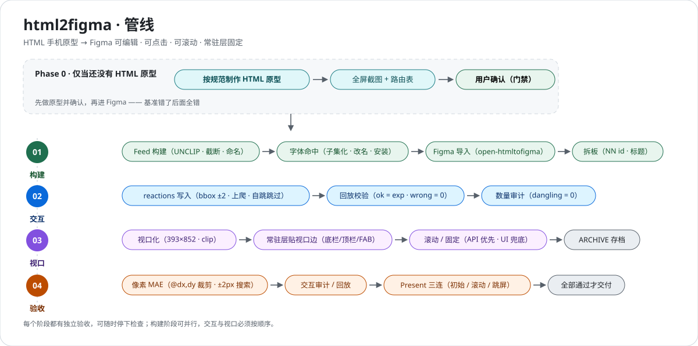

# html2figma

**简体中文** | [English](README.en.md)

**把 HTML 手机原型变成 Figma 里可编辑、可点击、可滚动的原型——没有 HTML 原型时，先按规范做出来并确认，再导入。**

Agent Skills 规范 · Figma 桌面端 · MIT

[](https://agentskills.io/specification)
[](https://www.figma.com/)
[](LICENSE)
[](CHANGELOG.md)
[](#%E4%BE%9D%E8%B5%96)

---

## 为什么做这个

把 HTML 导进 Figma 本身不难；**难的是让它像原型一样"能用"**。

常见的结果是每屏变成一张扁平长图：文字被 `-webkit-line-clamp` 截断却仍画到框外，底部导航落在 1800px 长图的末尾，页面不能滚动，所有跳转链接丢失。截图看着像，一按 Present 就露馅。

这个 skill 把整条路沉淀了下来——导入管线、字体命中、reaction 写入、视口重塑、Figma 插件的真实能力边界，以及证明结果正确的三层验收。

## 你会得到什么

- **可编辑图层**：每个元素都是 Frame / Text / Vector / 图片填充，不是切图。
- **真实跳转**：每个热区写成 `ON_CLICK → NAVIGATE` reaction，并用数量审计 + 回放双重校验。
- **真实滚动**：视口 Frame 带纵向滚动，行为和手机一致。
- **真正常驻的常驻层**：底栏、顶栏、FAB 该固定的固定。不写死 dock——skill 教 agent 如何判定什么该固定。
- **像素级还原**：导出 vs 参考的 MAE 比对，含阴影溢出裁剪与平移搜索。
- **导入前的检查点**：没有 HTML 原型时，先按规范产出一版、渲染全部屏幕、等用户确认，再碰 Figma。

## 工作方式

<p align="center">
  <picture>
    <source media="(prefers-color-scheme: dark)" srcset="assets/pipeline-dark.svg">
    
  </picture>
</p>

每个阶段都有独立验收，随时可以停下来检查。

## 安装

本仓库是一个 [Agent Skills](https://agentskills.io/specification) 包：`SKILL.md` + `references/` + `scripts/`。

```bash
git clone https://github.com/ilovemajiaqi/html2figma.git html2figma   # 或直接下载/复制这个文件夹
# 放进你的 agent 的 skills 目录，例如：
#   Claude Code:        ~/.claude/skills/html2figma
#   ZCode / 通用:       ~/.agents/skills/html2figma
#   项目级:             <project>/.agents/skills/html2figma
```

任何实现 Agent Skills 规范的客户端都能加载。SKILL.md 正文以中文写成，description 同时包含中英文触发词。

### 依赖

| 组件 | 用途 | 说明 |
|------|------|------|
| Figma **桌面端** | 导入插件、Prototype 面板、Present | 网页版不能导入本地开发插件（已发布插件可以） |
| [open-htmltofigma](https://github.com/kevicebryan/open-htmltofigma)（MIT） | HTML → Figma 图层 | **需单独安装**并固定 commit/tag；不在本仓库内 |
| Node.js + Chrome/CDP | feed 构建与截图 | 版本较新即可 |
| Python `fontTools` | 字体子集化/改名 | 需要精确字体命中时必装（Phase 3） |
| PowerShell（Windows） | 仓库内自动化脚本 | 可选；macOS/Linux 等价脚本未附带 |

上游插件安装（open-htmltofigma）：

```bash
git clone https://github.com/kevicebryan/open-htmltofigma.git
# 固定到某个 tag/commit 以便复现
git -C open-htmltofigma checkout <tag-or-commit>
```

然后在 Figma 桌面 → 菜单 **Plugins → Development → Import plugin from manifest…**，选择仓库里的 `manifest.json`。

## 使用

直接用自然语言描述任务即可（description 已按触发词写好）：

- 「把这个 HTML 原型转成 Figma 可编辑原型，dock 要固定在底部，能点击跳屏。」
- 「Figma 里底部栏跑到长图最下面了，而且页面不能滚动，修一下。」
- 「没有现成原型，先帮我做一版 HTML 手机原型，确认后再进 Figma。」

agent 会按 `SKILL.md` 执行，并按需加载 reference 文档。

## 常驻层：不止是 dock

常驻在屏幕上的可能是底部 tab 栏、顶部导航、悬浮按钮、浮条，也可能什么都没有。skill 给出判定流程（CSS 定位、z-index、跨屏重复、滚动行为）和决策表：

| 层的语义 | Figma 处理 |
|----------|------------|
| 始终覆盖的底栏/顶栏、FAB | 提到视口层，`Position = Fixed` |
| 随内容滚走 | 留在内容流里 |
| 滚动时自动隐藏 | 保留跟随/隐藏语义，或拆成状态屏——不确定就问用户 |
| 弹层/模态把手 | 属于该屏本身，不跨屏固定 |

当 HTML 的行为不足以判断时，skill 要求 agent 去查实际行为或直接问用户，而不是猜。

## 仓库结构

```text
html2figma/
├── SKILL.md                        # 入口：阶段、决策表、坑
├── README.md                       # 简体中文（默认，本文件）
├── README.en.md                    # English
├── assets/
│   ├── pipeline-light.svg          # 管线图（浅色）
│   └── pipeline-dark.svg           # 管线图（深色）
├── references/
│   ├── html-prototype-spec.md      # Phase 0 HTML 制作规范 + 用户确认门禁
│   ├── pipeline.md                 # feed、截断、字体、导入、reaction、视口化
│   ├── figma-ui-and-automation.md  # API/UI 能力边界、批量设置、设备模型、自动化
│   └── verification.md             # MAE、reaction 审计/回放、Present 检查
├── scripts/
│   ├── rename_font.py              # 子集化 + 字族改名（fontTools）
│   ├── install_font.ps1            # 当前用户安装/卸载 + WM_FONTCHANGE（Windows）
│   ├── figma_win.ps1               # 点击/悬停/按键/滚轮/截图（Windows）
│   ├── uia.ps1                     # UIA 枚举/点击/聚焦发键（Windows）
│   └── crop.mjs                    # 整数缩放 PNG 裁剪（跨平台）
├── evals/evals.json                # 触发与流程用例
├── CONTRIBUTING.md
├── CHANGELOG.md
└── LICENSE
```

## 质量门

三项全部通过才算完成：

1. **像素**——2x 导出 vs 参考：按 `@dx,dy` 裁掉阴影溢出，±2px 平移搜索。这里的 MAE 指重叠视口区域内 RGB 平均绝对差（0–255，隔 2–3px 采样）；3–10 属字体抗锯齿的正常范围，>15 需要排查。阈值来自单个项目的起点，不是标准。
2. **交互**——reaction 数量审计（`dangling == 0`）+ 用同一套命中/上爬逻辑回放（`ok == exp`、`wrong == 0`）。
3. **演示**——Present 三张截图：初始（常驻层在锚点）、滚动后（内容移动、常驻层不动）、跳屏后（目标屏且高亮态正确）。

本 skill 提取自的真实项目基线：51 屏、438 条热区定义 → 去自跳后 435 条导航动作、逐屏 MAE 4.05–10.51、滚动与固定底栏在 Present 实测通过。

## 兼容与限制

- 文档面向 **Figma 桌面端**。HTML/字体/导入环节与操作系统无关；仓库内自动化脚本仅 Windows，macOS/Linux 等价脚本未附带（可用 AppleScript / `screencapture` / `xdotool` 改写，或按文档手动操作）。
- 滚动与固定子层**都可以走 API**：`overflowDirection = 'NONE' | 'VERTICAL' | 'HORIZONTAL' | 'BOTH'`；`numberOfFixedChildren = N`（固定层必须是前 N 个子层）。Prototype 面板作为兜底，两条路文档里都写了。
- `open-htmltofigma` 从渲染后的 iframe 取几何；它会剥掉脚本，所以交互必须重写（skill 覆盖了这一点）。
- Figma 网页版不能导入本地开发插件，这一步需要桌面端。

## FAQ

**为什么不用 `.sketch` 路线？** 能用，但需要自写 extractor，每次导入都丢 flow，文字度量也不如直接从渲染后的 DOM 建。skill 选 DOM 路线，因为可复现。

**为什么 Figma 里断行不一样？** 字体被替换了。导入前先子集化、改名、安装精确字体；文档里有完整步骤。

**Figma 明明能原生截断，为什么还要烘焙？** 先试原生（`textTruncation='ENDING'` + `maxLines`）。只有要求断行与浏览器逐字一致时才烘焙；skill 两条路都写了，并要求 agent 先对比再选。

**Present 里为什么滚不动？** 视口 Frame 没设 Overflow，或滚动内容被放进了固定层。查验收手册。

**reaction 为什么会消失？** 跨页克隆后再写 reaction 会批量失败。要交互就原地重构，另开 ARCHIVE 页存档。

## 贡献

欢迎 issue 和 PR，见 [CONTRIBUTING.md](CONTRIBUTING.md)。如果你遇到了新的失败模式，一个最小复现（HTML 片段 + 期望 vs 实际 Figma 行为）比一段描述有用得多。请保持 `SKILL.md` 在 500 行以内，细节放进 `references/`。

## 许可

MIT，见 [LICENSE](LICENSE)。

## 致谢

- [open-htmltofigma](https://github.com/kevicebryan/open-htmltofigma)（MIT）：HTML → Figma 转换核心。
- [Agent Skills 规范](https://agentskills.io/specification) 与 Anthropic 的 skill 编写指南：包格式依据。
